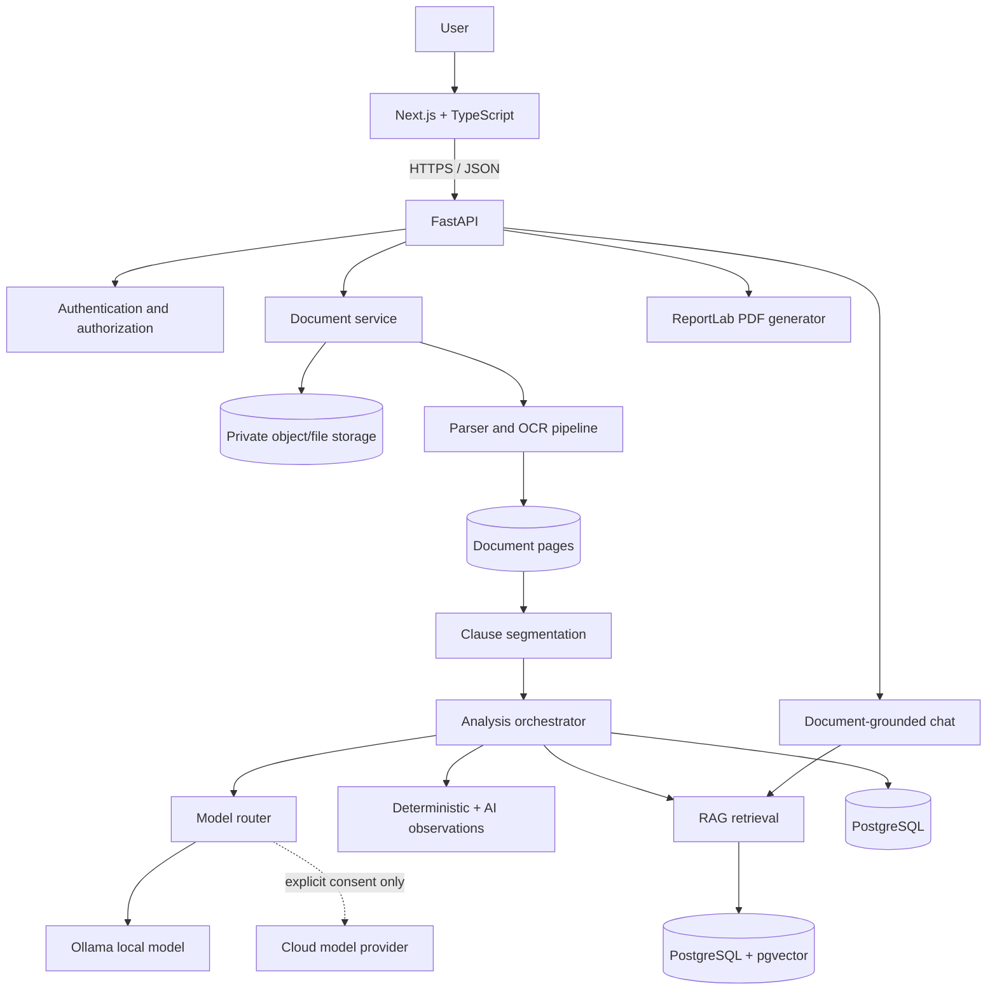
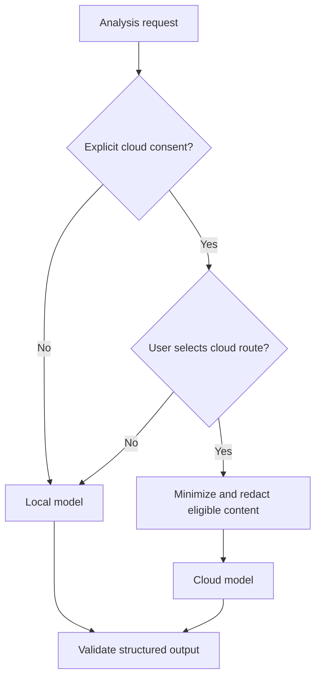

# Legal Lite — System Architecture

**Status:** Hackathon implementation baseline  
**Initial document type:** Indian rental agreements  
**Languages:** English and Hindi  
**Inference:** Local-first hybrid; cloud only with explicit consent

## 1. Goals and non-goals

### Goals
- Explain legal-document wording in accessible language.
- Preserve the exact source text and page/section provenance.
- Identify potential ambiguity and commercial/legal concerns with evidence.
- Answer questions using the uploaded document and curated legal sources.
- Protect sensitive documents through private storage and local-first inference.
- Produce a traceable PDF report.

### Non-goals for the MVP
- Giving legal advice or predicting case outcomes.
- Certifying legality, validity, enforceability, or compliance.
- Replacing a lawyer, registrar, tax professional, or government portal.
- Supporting every Indian language or every document type.
- Fine-tuning a foundation model during the hackathon.

## 2. High-level architecture

## 3. Technology choices

| Concern | Baseline | Notes |
|---|---|---|
| Web UI | Next.js, TypeScript | Responsive document workspace |
| UI styling | Tailwind CSS, shadcn/ui | Accessible components |
| API | FastAPI, Pydantic | Typed request/response validation |
| Database | PostgreSQL | Metadata, users, analysis, chat |
| Vector search | pgvector | Legal-source chunks and embeddings |
| PDF extraction | PyMuPDF | Page-level text and metadata |
| DOCX extraction | python-docx / Docling | Paragraphs and tables |
| OCR | PaddleOCR | Fallback for scanned/low-text pages |
| Local inference | Ollama + evaluated Qwen instruct model | Default route |
| Embeddings | BGE-M3 or benchmarked multilingual model | English/Hindi retrieval |
| PDF report | ReportLab | Server-side report generation |
| Runtime | Docker Compose | Reproducible development |

Keep parser, model, embedding, storage, and report providers behind small interfaces so the team can replace implementations without changing API contracts.

## 4. Core services

### 4.1 Frontend
- Authentication and document list.
- Drag-and-drop upload with validation feedback and processing status.
- Document viewer with page navigation.
- Clause cards showing original text, explanation, category and page.
- English/Hindi language switch.
- Attention panel with evidence excerpt and suggested question.
- Document-specific chat with navigable citations.
- Report generation and authorized download.

### 4.2 API and application layer
- Authenticate users and enforce resource ownership.
- Validate uploads and create processing jobs.
- Orchestrate parsing, analysis, chat and report workflows.
- Return stable, versioned response schemas.
- Avoid placing document contents in logs.

### 4.3 Document pipeline
1. Validate extension, MIME type, file signature, size and page count.
2. Store original in private storage under a generated identifier.
3. Extract PDF text page by page; extract DOCX paragraphs/tables.
4. Detect pages with insufficient native text.
5. Apply OCR only where needed; mark OCR-derived text and confidence.
6. Persist page text, extraction method, quality and page number.
7. Segment clauses while preserving exact text, offsets and page references.

### 4.4 Analysis orchestrator
- Classify clauses into a controlled taxonomy.
- Generate structured English and Hindi explanations.
- Run deterministic checks for known ambiguity patterns.
- Ask the model for additional evidence-linked observations.
- Validate every clause ID and quoted excerpt against stored source text.
- Save model/provider/version and analysis status.

## 5. Hybrid model routing and privacy

Local inference is the default. A cloud provider may be used only after a user explicitly opts in for that processing action.

Requirements:
- Never silently send documents to cloud after a local timeout/failure.
- Show which provider is being used before cloud processing.
- Minimize data sent; redact where feasible and safe.
- Do not send more pages/clauses than required.
- Record provider, model identifier, time and consent state, not raw document text.
- Handle provider errors without leaking content.

Define a common model adapter such as `generate_structured(prompt, schema, options)`. Provider-specific SDKs must remain inside adapters.

## 6. Clause and risk model

Initial clause categories:
`rent`, `deposit`, `maintenance`, `termination`, `notice`, `penalty`, `renewal`, `liability`, `dispute_resolution`, `other`.

Attention categories:
- `legal_concern`
- `contractual_ambiguity`
- `commercial_concern`

Attention levels: `high`, `medium`, `low`.

Potential initial checks:
- Deposit refund deadline absent or unclear.
- Penalty amount or calculation unspecified.
- Termination notice period unclear.
- Liability wording unusually broad or undefined.
- Automatic renewal conditions unclear.
- Maintenance responsibilities not allocated.

Each observation must contain:
- observation ID and category/level;
- clause ID and page reference;
- exact supporting excerpt verified against source text;
- concise reason, uncertainty and suggested question;
- optional legal-source reference, only when retrieved and contextually relevant.

These are review prompts, not legal verdicts. A missing clause is an ambiguity to investigate, not automatically an illegal term.

## 7. Retrieval-augmented generation (RAG)

### Source policy
Prefer official, authoritative sources:
- India Code
- Legislative Department
- Central Board of Indirect Taxes and Customs (CBIC)
- GST Portal

Only ingest sources relevant to the selected document type and jurisdiction. Verify URLs and source versions.

### Metadata per source/chunk
- source ID, title and canonical URL;
- publisher/authority;
- jurisdiction and document type;
- act/rule/section/provision identifier;
- publication/version/effective-date metadata when verified;
- chunk text and embedding model/version.

### Retrieval flow
1. Build a query from the user's question and relevant clause context.
2. Apply jurisdiction/document-type filters.
3. Retrieve vector matches; optionally combine keyword search.
4. Return source chunks with stable IDs and provision metadata.
5. Pass only retrieved context to the model.
6. Validate that returned citations refer to retrieved source IDs.
7. If evidence is insufficient, say so rather than inventing an answer.

Do not fine-tune for the hackathon MVP. Start with retrieval, constrained prompts, structured validation and a small reviewed evaluation set.

## 8. Data model (initial)

| Table | Important fields |
|---|---|
| users | id, email, password_hash/auth_subject, created_at |
| documents | id, owner_id, filename, storage_key, mime_type, status, created_at |
| document_pages | id, document_id, page_number, text, extraction_method, quality |
| clauses | id, document_id, page_start, page_end, category, original_text, offsets |
| analyses | id, document_id, status, model_provider, model_name, language, created_at |
| clause_explanations | id, analysis_id, clause_id, language, explanation, key_points |
| risk_observations | id, analysis_id, clause_id, category, level, excerpt, reason, suggested_question |
| legal_sources | id, title, url, publisher, jurisdiction, version_metadata |
| legal_chunks | id, source_id, provision, content, embedding, embedding_model |
| chat_sessions | id, owner_id, document_id, created_at |
| chat_messages | id, session_id, role, content, citations, created_at |
| reports | id, document_id, analysis_id, storage_key, created_at |

Use UUIDs, foreign keys, indexes, created/updated timestamps and ownership checks. Store embeddings with a model/version identifier.

## 9. Security and privacy controls

- Private object storage; never expose storage keys as public URLs.
- Enforce owner checks for document, analysis, chat and report resources.
- Validate file signatures; do not trust filename or browser MIME alone.
- Set upload/page limits and processing timeouts.
- Sanitize filenames and use generated storage names.
- Protect secrets with environment variables; commit only `.env.example`.
- Avoid raw prompt/document logging.
- Provide document deletion with file and derived-data cleanup.
- Use synthetic documents in tests, screenshots and demos.
- Rate-limit expensive model and OCR operations.
- Escape document text in UI; treat uploaded content as untrusted input.

## 10. Deployment

Local development should use Docker Compose for API, database and frontend where practical. Ollama may run on the host or a dedicated private service. Do not expose Ollama publicly.

Required environment groups:
- database connection;
- private storage path/provider;
- authentication/session secrets;
- local model endpoint and model identifier;
- optional cloud provider key (only if enabled);
- CORS and allowed origins.

Add health checks, structured logs without sensitive content, request IDs, error monitoring and database migrations.

## 11. Evaluation and acceptance criteria

Measure on reviewed synthetic examples:
- page extraction and OCR quality;
- clause segmentation accuracy;
- explanation meaning preservation;
- Hindi terminology quality;
- risk observation precision;
- citation validity;
- retrieval relevance;
- safe insufficient-evidence behavior.

MVP acceptance:
- upload a synthetic rental agreement;
- display extracted clauses with page numbers;
- explain clauses in English and Hindi;
- show at least one verified evidence-linked observation;
- answer a document question with valid references;
- generate a downloadable report;
- demonstrate local-first inference and explicit cloud consent.

## 12. Known limitations

Scanned handwriting, poor scans, unusual formatting, ambiguous drafting and legal changes may reduce reliability. Always show uncertainty and source text. The system must not claim legal validity, legal compliance, or professional advice.
