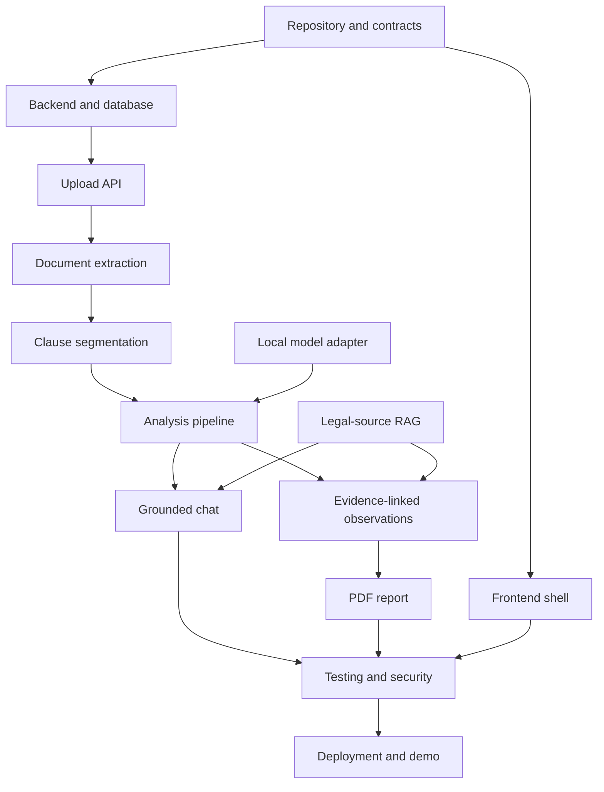

# Legal Lite — Development Tasks

**Team size:** 3–4  
**Target:** 72-hour hackathon build  
**MVP:** Indian rental agreement understanding  
**Priority legend:** P0 = demo-critical; P1 = valuable if time permits

## 1. Definition of done

A task is done when:
- Acceptance criteria are met and relevant tests pass.
- Error/loading/empty states are handled where applicable.
- No secrets or real personal documents are committed.
- API contracts and docs are updated if behavior changes.
- The change is reviewed and integrated into the agreed branch.

## 2. Suggested team ownership

| Role | Main responsibility |
|---|---|
| Frontend lead | Next.js UI, upload, clause viewer, risk panel, chat, reports |
| Backend lead | FastAPI, database, auth, storage, API contracts |
| AI/ML lead | Local model adapter, prompts, embeddings, RAG, evaluation |
| Document intelligence/integration lead | PDF/DOCX parsing, OCR, legal sources, Docker, integration |

For a 3-person team, combine document intelligence with backend/integration.

## 3. GitHub workflow

- Keep `main` stable; use `feat/*`, `fix/*`, and `docs/*` branches.
- Create focused pull requests with a short test plan.
- Integrate at least twice per day.
- Use mock API responses so frontend work can proceed in parallel.
- Update `API_SPECIFICATION.md` before merging breaking API changes.
- Never commit `.env`, API keys, model weights, private agreements or real personal data.

Recommended labels: `priority:P0`, `priority:P1`, `area:frontend`, `area:backend`, `area:ai`, `area:documents`, `area:security`, `type:bug`, `type:feature`, `type:docs`.

## 4. Backlog

### Repository and product foundation

#### LL-001 — Repository setup
**Owner:** Integration lead · **Priority:** P0

- Add frontend/backend/docs/infra/tests/sample_docs structure.
- Add README, architecture, API specification and task backlog.
- Add `.gitignore`, `.env.example`, formatting/lint configuration.
- Add branch and PR conventions.

**Acceptance:** New teammate can clone repo, understand the stack and find assigned work.

#### LL-002 — API contract and shared schemas
**Owner:** Backend lead + AI/ML lead · **Priority:** P0

- Align endpoint paths and JSON envelopes with API specification.
- Define shared Pydantic response models.
- Define stable status and error codes.
- Create example fixtures for frontend.

**Acceptance:** Frontend and backend can work against the same documented contract.

#### LL-003 — Synthetic rental agreement
**Owner:** Document intelligence lead · **Priority:** P0

- Create a synthetic agreement with rent, deposit, maintenance, termination, notice, penalty and renewal clauses.
- Include no real personal data.
- Record expected clauses and page numbers.
- Have a legally knowledgeable reviewer check demo wording where possible.

**Acceptance:** Team has a safe demo PDF and expected-analysis checklist.

### Phase 1 — Upload and extraction (Hours 4–12)

#### LL-010 — Upload UI
**Owner:** Frontend · **Priority:** P0
- Drag-and-drop and file picker.
- PDF/DOCX guidance, progress, retry and processing status.

**Acceptance:** User can upload a supported file and understand validation/API errors.

#### LL-011 — Upload endpoint
**Owner:** Backend · **Priority:** P0
- Implement `POST /documents/upload`.
- Validate signature, MIME, size and page limits.
- Generate safe storage key and persist metadata privately.

**Acceptance:** Valid files accepted; unsupported/oversized files rejected; no public file access.

#### LL-012 — PDF extraction
**Owner:** Documents · **Priority:** P0
- Extract page-by-page with PyMuPDF.
- Preserve 1-based page numbers.
- Detect empty/scanned pages and handle malformed/encrypted PDFs.

**Acceptance:** Text PDFs return page-level text; scanned pages are flagged for OCR.

#### LL-013 — DOCX extraction
**Owner:** Documents · **Priority:** P1
- Extract paragraphs/tables using python-docx or Docling.
- Preserve headings/structure where practical.

**Acceptance:** Basic DOCX documents are supported; unsupported structures fail clearly.

#### LL-014 — OCR fallback
**Owner:** Documents · **Priority:** P1
- Render low-text pages and run PaddleOCR.
- Store OCR output and confidence separately.
- Mark OCR-derived text as uncertain where appropriate.

**Acceptance:** Scanned sample page is readable and clearly identified as OCR output.

#### LL-015 — Persist pages
**Owner:** Backend · **Priority:** P0
- Create document page records.
- Store text, extraction method and quality.
- Add authorized retrieval and deletion cleanup.

**Acceptance:** Page text can be fetched only by the owning user.

### Phase 2 — Clauses and explanations (Hours 12–24)

#### LL-020 — Clause segmentation
**Owner:** Documents · **Priority:** P0
- Detect numbered clauses/headings.
- Preserve exact text, offsets and page mapping.
- Add fallback segmentation for unnumbered documents.

**Acceptance:** Demo clauses are separated without silently dropping content.

#### LL-021 — Clause classification
**Owner:** AI/ML · **Priority:** P0
- Categories: rent, deposit, maintenance, termination, notice, penalty, renewal, liability, dispute resolution, other.
- Add rule-based cues and model fallback.
- Validate category against allowed values.

**Acceptance:** Every clause has a valid category or `other`.

#### LL-022 — Local model adapter
**Owner:** AI/ML · **Priority:** P0
- Run Ollama and benchmark a candidate Qwen instruct model.
- Implement provider-neutral adapter, timeout and connection handling.
- Record model name/version.

**Acceptance:** API can make a local test call and recover gracefully from model failure.

#### LL-023 — Structured simplification
**Owner:** AI/ML · **Priority:** P0
- Write prompts preserving rights, duties, conditions and exceptions.
- Require structured JSON and validate with Pydantic.
- Retry malformed output once; mark uncertainty.

**Acceptance:** Explanations are valid, grounded and do not modify original clause text.

#### LL-024 — Hindi explanation
**Owner:** AI/ML · **Priority:** P0
- Generate Hindi explanations.
- Maintain legal terminology glossary.
- Preserve names, dates, amounts and conditions.
- Review demo-critical examples.

**Acceptance:** English/Hindi views are available and reviewed examples preserve meaning.

#### LL-025 — Analysis API
**Owner:** Backend · **Priority:** P0
- Persist analysis status and results.
- Implement analyze, status and clause retrieval endpoints.

**Acceptance:** Analysis can be started, polled and reloaded.

#### LL-026 — Analysis workspace
**Owner:** Frontend · **Priority:** P0
- Summary, clause cards, original/explained text, language switch and page references.
- Add loading, empty and error states.

**Acceptance:** User can navigate clauses and see source pages.

### Phase 3 — Attention flags and RAG (Hours 24–40)

#### LL-030 — Observation taxonomy
**Owner:** AI/ML · **Priority:** P0
- Categories: legal concern, contractual ambiguity, commercial concern.
- Levels: high, medium, low.

**Acceptance:** Taxonomy is documented as attention prompts, not legal verdicts.

#### LL-031 — Deterministic checks
**Owner:** AI/ML · **Priority:** P0
- Missing deposit refund deadline.
- Unspecified penalty calculation.
- Unclear termination notice.
- Broad liability.
- Automatic renewal ambiguity.
- Unclear maintenance responsibility.

**Acceptance:** Each rule links to source clause and has positive/negative tests.

#### LL-032 — Evidence-linked model observations
**Owner:** AI/ML · **Priority:** P0
- Require clause ID and supporting excerpt.
- Verify excerpt against source text.
- Include reason, uncertainty and neutral suggested question.
- Reject unsupported claims.

**Acceptance:** No observation is shown without valid clause evidence.

#### LL-033 — Official source ingestion
**Owner:** Documents · **Priority:** P0
- Start with a small set of official sources relevant to rental agreements.
- Verify authority, jurisdiction, URL and provision.
- Store version/effective-date metadata only when verified.

**Acceptance:** Every knowledge-base passage resolves to a traceable source.

#### LL-034 — Embeddings and vector storage
**Owner:** AI/ML · **Priority:** P0
- Evaluate BGE-M3 or multilingual alternative.
- Chunk by legal provision.
- Store vectors in pgvector with metadata filters.

**Acceptance:** Test queries retrieve relevant chunks and source records.

#### LL-035 — RAG retrieval
**Owner:** AI/ML · **Priority:** P0
- Query using clause and question context.
- Filter jurisdiction and document type.
- Add optional keyword search and retrieval diagnostics.

**Acceptance:** Known test questions retrieve expected provisions with stable IDs.

#### LL-036 — Grounded answers and citations
**Owner:** AI/ML + Backend · **Priority:** P0
- Add retrieved context to prompts.
- Validate cited IDs against retrieved sources.
- Add insufficient-evidence behavior.

**Acceptance:** Citations resolve; unsupported claims are qualified or omitted.

#### LL-037 — Observation panel UI
**Owner:** Frontend · **Priority:** P0
- Show level, category, reason, excerpt, page, suggested question and sources.
- Link observation to clause.
- Display disclaimer.

**Acceptance:** Selecting an observation navigates to its source clause.

### Phase 4 — Chat and report (Hours 40–52)

#### LL-040 — Document-specific chatbot
**Owner:** AI/ML · **Priority:** P0
- Retrieve relevant clauses and legal chunks.
- Generate grounded answer with citations and uncertainty.

**Acceptance:** Chat is scoped to selected document and does not invent source IDs.

#### LL-041 — Chat API and persistence
**Owner:** Backend · **Priority:** P0
- Store sessions/messages.
- Enforce document ownership.
- Avoid sensitive prompt logging.

**Acceptance:** Owner can reopen chat; other users cannot read it.

#### LL-042 — Chat UI
**Owner:** Frontend · **Priority:** P0
- Chat panel, suggested questions, citation chips, loading/retry states.

**Acceptance:** Citations navigate to source clause/page.

#### LL-043 — PDF report
**Owner:** Backend · **Priority:** P0
- ReportLab template with summary, clauses, explanations, observations, citations, date and disclaimer.
- Store report privately.

**Acceptance:** Report is readable, traceable and authorized.

#### LL-044 — Report download UI
**Owner:** Frontend · **Priority:** P0
- Generate action, status, authorized download and errors.

**Acceptance:** Owner can download report; another user cannot.

#### LL-045 — Cloud adapter and consent
**Owner:** AI/ML + Backend · **Priority:** P1
- Add one optional cloud provider.
- Explicit opt-in UI and server enforcement.
- Minimize/redact content and handle failures.

**Acceptance:** Local is default; no cloud call without consent; no silent fallback.

### Phase 5 — Testing and hardening (Hours 52–64)

#### LL-050 — End-to-end tests
**Owner:** All · **Priority:** P0
Test upload, extraction, clauses, English/Hindi explanations, observations, RAG, chat, report and deletion.

**Acceptance:** Primary demo workflow completes repeatedly with recoverable errors.

#### LL-051 — Security tests
**Owner:** Backend · **Priority:** P0
Test unauthenticated and cross-user access, upload validation, size limits, deletion and sensitive logging.

**Acceptance:** Unauthorized access is rejected and logs contain no document text/secrets.

#### LL-052 — AI evaluation
**Owner:** AI/ML · **Priority:** P0
Build 30–50 reviewed examples where feasible. Measure segmentation, meaning preservation, observation precision, citation correctness, retrieval and Hindi quality.

**Acceptance:** Demo findings are manually verified; limitations are documented; no unmeasured accuracy claims.

#### LL-053 — OCR and malformed files
**Owner:** Documents · **Priority:** P1
Test scanned, rotated, low-quality, multi-column, empty, encrypted and malformed PDFs.

**Acceptance:** Failures are graceful and OCR uncertainty is visible.

#### LL-054 — UI polish
**Owner:** Frontend · **Priority:** P0
Check desktop/mobile, loading states, PDF viewer, navigation, errors, privacy and disclaimers.

**Acceptance:** Demo is usable at presentation resolution without major layout issues.

### Phase 6 — Deployment and presentation (Hours 64–72)

#### LL-060 — Dockerize
**Owner:** Backend + Integration · **Priority:** P0
Add frontend/backend Dockerfiles, PostgreSQL/pgvector, environment variables and health checks.

**Acceptance:** Fresh environment starts using documented commands; no secret is baked into image.

#### LL-061 — Deploy
**Owner:** Integration · **Priority:** P0
Deploy frontend/API, configure HTTPS/CORS/database, verify private model connectivity and cloud consent.

**Acceptance:** Demo URL works; Ollama is not publicly exposed.

#### LL-062 — Fallback demo
**Owner:** Integration + Frontend · **Priority:** P0
Prepare synthetic agreement, pre-run analysis, screenshots, short recording and local fallback.

**Acceptance:** Demo remains possible if network/model hosting fails.

#### LL-063 — Presentation
**Owner:** All · **Priority:** P0
Slides: problem, users, solution, demo, architecture, AI/RAG, privacy, evaluation/limitations, potential and roadmap.

**Acceptance:** Claims are demonstrable and limitations are stated honestly.

## 5. 72-hour execution sequence

| Window | Primary outcome |
|---|---|
| Hours 0–4 | Repository, API contract, synthetic sample, frontend/backend skeleton |
| Hours 4–12 | Upload, private storage, PDF extraction |
| Hours 12–24 | Clause segmentation, local model, English/Hindi explanations |
| Hours 24–40 | Attention observations, official sources, RAG |
| Hours 40–52 | Grounded chat and PDF report |
| Hours 52–64 | End-to-end, security, AI and OCR evaluation |
| Hours 64–72 | Docker/deployment, fallback demo and presentation |

## 6. Dependency map

Frontend can proceed with mock data while backend/AI work is in progress.

## 7. Demo success checklist

- [ ] Upload one synthetic rental agreement.
- [ ] Show extracted clauses and page numbers.
- [ ] Explain a clause in plain English.
- [ ] Switch to Hindi.
- [ ] Show one verified evidence-linked observation.
- [ ] Ask a question and show source references.
- [ ] Download the report.
- [ ] Explain local-first inference and explicit cloud consent.
- [ ] State that the system is not legal advice or a validity certificate.

## 8. Team integration rules

- Pull the integration branch before starting work.
- Use feature branches and small pull requests.
- Integrate at least twice daily.
- Run relevant tests before merging.
- Update API specification for contract changes.
- Keep a known-good demo path.
- Never commit `.env`, private agreements, model weights or real personal data.
