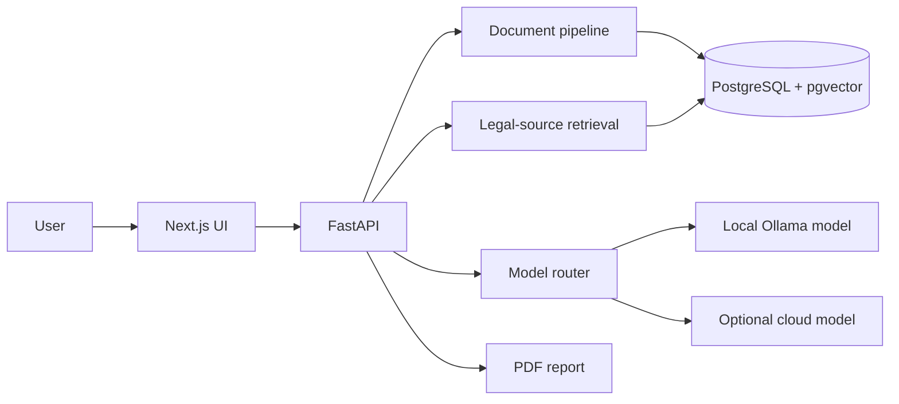

# Legal Lite

**Understand legal documents without needing legal language expertise.**

Legal Lite is a privacy-aware AI assistant that helps people understand Indian legal documents—starting with rental agreements—through plain-language explanations, Hindi translations, evidence-linked attention flags, and document-grounded Q&A.

> **Important:** Legal Lite provides legal information and document understanding, not legal advice. Its attention flags are prompts for review, not findings of illegality, enforceability, or legal validity. Consult a qualified lawyer for decisions.

## Problem

Contracts and government/legal documents often contain dense language, unfamiliar terms, and obligations that are difficult for everyday users to interpret. Users may overlook unclear conditions, missing details, or commercially unfavorable wording.

## Proposed solution

1. Upload a PDF or DOCX agreement.
2. Extract text while retaining page-level provenance.
3. Segment the document into clauses.
4. Explain clauses in plain English and Hindi.
5. Highlight potential ambiguity or commercial/legal concerns with the exact supporting clause.
6. Ask questions grounded in the uploaded document and curated legal sources.
7. Export a shareable PDF report.

## Initial scope

The hackathon MVP focuses on **Indian rental agreements**. The architecture is designed to extend later to other contracts and selected GST-related documents, but those are not MVP promises.

### MVP features

- PDF/DOCX upload with validation and private storage
- Page-aware text extraction and OCR fallback
- Clause segmentation and classification
- English/Hindi plain-language explanations
- Evidence-linked attention observations
- Document-specific Q&A with source references
- PDF report generation
- Local inference by default; cloud inference only after explicit consent

## Architecture at a glance



See [ARCHITECTURE.md](ARCHITECTURE.md) for the detailed design and [API_SPECIFICATION.md](API_SPECIFICATION.md) for endpoint contracts.

## Technology stack

| Layer | Planned technology |
|---|---|
| Frontend | Next.js, TypeScript, Tailwind CSS, shadcn/ui |
| Backend | Python, FastAPI, Pydantic |
| Database | PostgreSQL, pgvector |
| PDF parsing | PyMuPDF |
| DOCX parsing | python-docx / Docling |
| OCR fallback | PaddleOCR |
| Local model runtime | Ollama with an evaluated Qwen instruct model |
| Embeddings | BGE-M3 or an evaluated multilingual alternative |
| Reports | ReportLab |
| Development | Docker Compose, GitHub |

Technology choices may be adjusted after a small benchmark; keep interfaces provider-agnostic.

## Repository layout

```text
Legal-Lite-/
├── frontend/                 # Next.js application
├── backend/                  # FastAPI application
├── docs/                     # Product and engineering documentation
├── infra/                    # Docker and deployment configuration
├── tests/                    # Integration and evaluation tests
├── sample_docs/              # Synthetic demo documents only
├── ARCHITECTURE.md
├── API_SPECIFICATION.md
├── DEVELOPMENT_TASKS.md
└── README.md
```

## Getting started

This repository currently contains the engineering plan and scaffold. Application services are added in the implementation tasks.

### Prerequisites

- Git
- Node.js LTS and npm/pnpm
- Python 3.11+
- Docker and Docker Compose
- Ollama (for local model inference)

### Clone

```bash
git clone https://github.com/r3con-ng/Legal-Lite-.git
cd Legal-Lite-
```

### Development workflow

1. Read [ARCHITECTURE.md](ARCHITECTURE.md).
2. Agree on request/response contracts in [API_SPECIFICATION.md](API_SPECIFICATION.md).
3. Pick an unassigned task from [DEVELOPMENT_TASKS.md](DEVELOPMENT_TASKS.md).
4. Create a feature branch: `git switch -c feat/short-description`.
5. Open a pull request against `main` (or the team's agreed integration branch).
6. Add tests and update docs when contracts or architecture change.

## Privacy and security principles

- Local model inference is the default.
- No document is sent to a cloud model without explicit user consent.
- Never silently fall back from local to cloud inference.
- Keep uploaded documents private and enforce ownership on every document, analysis, chat, and report route.
- Do not log document contents, secrets, or personal data.
- Use synthetic agreements in demos and committed fixtures.
- Validate file type, signature, size, and page count.

## Legal-source policy

Use curated, official sources where possible, including India Code, the Legislative Department, CBIC, and the GST Portal. Store source title, URL, jurisdiction, provision/section, version, and verified effective-date metadata. Do not claim that a provision applies without checking context and jurisdiction.

## Team roles

- **Frontend lead:** upload flow, analysis workspace, risk panel, chat and report UI.
- **Backend lead:** FastAPI, persistence, authorization, upload and report APIs.
- **AI/ML lead:** model routing, prompts, embeddings, RAG and evaluation.
- **Document intelligence/integration lead:** parsing, OCR, legal-source ingestion, Docker and integration.

## Hackathon demo path

Upload a synthetic rental agreement → review extracted clauses → switch English/Hindi explanations → inspect an evidence-linked attention flag → ask a question → download the report.

## Contributing

Keep pull requests focused, document API changes, add tests for new behavior, and never commit secrets or real private agreements. See [DEVELOPMENT_TASKS.md](DEVELOPMENT_TASKS.md).

## License

A license has not yet been selected. Until one is added, do not assume this repository grants permission to reuse or redistribute its contents.
